<div align="center">

# Rastro

**AI that traces every head of cattle back to the ranch where it was born, and a shared ledger that refuses the paperwork laundering depends on.**

*A cow is born once, dies once, and can't be in two places. Neither can its paperwork.*


IEEE ClimateChain Global Hackathon 2026 · Track: **Sustainable Supply Chains** · Team **Rastro**

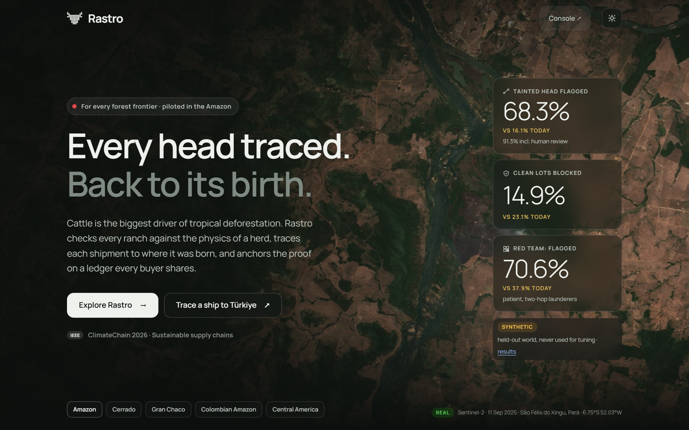

</div>

> [!IMPORTANT]
> **Synthetic ranches, real landscape.** Deforestation, Indigenous lands, protected areas, the municipal herd and the
> slaughterhouse and port locations are real public data. Every ranch boundary, herd, birth, permit (GTA), embargo and
> laundering behaviour is simulated. Slaughterhouse names are anonymised. Nothing here describes a real ranch or company.

---

## Contents

1. [The problem](#1-the-problem)
2. [What Rastro does](#2-what-rastro-does)
3. [Results](#3-results)
4. [System overview](#4-system-overview)
5. [How it works](#5-how-it-works)
   [Pipeline](#51-from-satellite-layer-to-certificate) ·
   [HerdLedger](#52-herdledger-conservation-of-cattle) ·
   [Lineage](#53-lot-lineage) ·
   [Risk engine](#54-risk-engine-and-verdicts) ·
   [Certificates](#55-one-time-certificates)
6. [Screenshots](#6-screenshots)
7. [Getting started](#7-getting-started)
8. [Demo in five minutes](#8-demo-in-five-minutes)
9. [Project structure and tech stack](#9-project-structure-and-tech-stack)
10. [Testing](#10-testing)
11. [Security and trust model](#11-security-and-trust-model)
12. [Who would use it](#12-who-would-use-it)
13. [Limitations and roadmap](#13-limitations-and-roadmap)
14. [Real and synthetic data](#14-real-and-synthetic-data)
15. [Editing the diagrams](#15-editing-the-diagrams)
16. [Sources](#16-sources)
17. [Team](#17-team)

---

## 1. The problem

Cattle pasture is the largest driver of deforestation in the Amazon. Meatpackers check their **direct** suppliers, so
the animals get laundered:

<p align="center">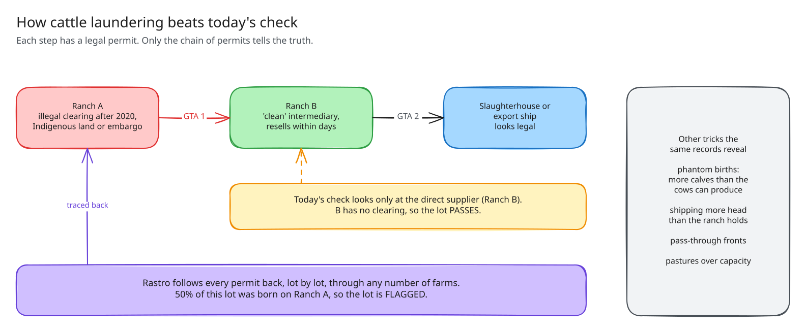</p>

Every one of those movements already has an animal transit permit (GTA). Nobody connects them across buyers:

| Fact | Why it matters |
| --- | --- |
| **Pará pushed individual cattle tracking back to 2030** (Dec 2025). The federal deadline is 2032. | Ear tags won't close the gap for years. Permits are what exists now. |
| **EUDR applies to beef from 30 Dec 2026**, with a deforestation cut-off of 31 Dec 2020. | EU importers need origin evidence beyond the direct supplier within weeks. |
| **A federal court ruled that Pará must publish its GTA data** (final ruling, 8 Oct 2025). | The data is opening, but there is no neutral way for competing buyers to use it. |
| **Human Rights Watch (Oct/Nov 2025)** traced illegal Pará ranches into a major meatpacker's supply chain through intermediaries. | A single company's traceability platform, built on self-declarations, doesn't stop indirect laundering. |
| **Pará ships more than half of Brazil's live-cattle exports**, mostly to Egypt, Iraq, Lebanon, Morocco and **Türkiye, Brazil's largest live-cattle buyer** and host of COP31. | These animals are outside EUDR. As the EU closes its door, tainted cattle look for other ones. |

<details>
<summary><b>New to Brazilian cattle supply chains? A 30-second glossary</b></summary>

| Term | Meaning |
| --- | --- |
| **GTA** (Guia de Trânsito Animal) | The state permit required to move cattle between properties or to slaughter. Each one records origin, destination, date and head count. |
| **Direct supplier** | The last ranch before the slaughterhouse. The only one most audits check. |
| **Indirect supplier** | Any ranch further back: where the calf was born or raised. Where most deforestation risk sits. |
| **PRODES** | INPE's annual satellite mapping of clear-cut deforestation in the Brazilian Amazon. |
| **Embargo** | An Ibama sanction that bars a property from selling after illegal clearing. |
| **EUDR** | The EU Deforestation Regulation: cattle products sold in the EU must come from land not deforested after 31 Dec 2020. |
| **Laundering** | Moving cattle from a blocked ranch through a clean one so they arrive looking legal. |

</details>

## 2. What Rastro does

| # | Capability | What it means for a buyer |
| --- | --- | --- |
| 1 | **Conservation of cattle, on-chain** | HerdLedger refuses a permit for more head than a ranch holds, births above what its breeding cows can produce, and any movement from an embargoed ranch. The rules hold for every buyer at once. |
| 2 | **Lot lineage** | Every permit is a lot with a date and an origin mix. Rastro follows lots through any number of farms and reports what share of a shipment was born on risky land. |
| 3 | **Laundering detection (AI)** | Five detectors look for post-cut-off clearing, impossible inventories, pass-through fronts, over-capacity pastures and unusual behaviour (IsolationForest). Every finding carries its values, thresholds and a plain-language reason. |
| 4 | **One-time certificates** | A clean lot gets an oracle-signed EIP-712 certificate. Each permit can back only one certificate, and each certificate can be used once: one export or one EUDR statement. |
| 5 | **Tamper-evident evidence** | Every certificate anchors the SHA-256 of its canonical evidence bundle. Anyone can re-hash the file and check that nobody edited it. |

**Why a blockchain.** The state agency, regulators, competing meatpackers, exporters and importers don't trust each
other and don't share data. A single company's database is exactly the gap launderers already use. HerdLedger is a
neutral, shared rulebook. Only salted hashes go on-chain, which answers the privacy objection Pará raised against
publishing GTAs, and a "clean" status can be spent only once.

**Why AI.** The ledger catches what is physically impossible. Laundering that stays within physics (a front ranch that
buys and resells within days, a lot that is half tainted) needs pattern detection and lineage across many permits.

## 3. Results

Evaluated on **11 held-out synthetic worlds** (seed 101, never used for tuning), each 409 ranches and about 10,800
permits over three years on the real landscape around São Félix do Xingu, Pará. "Today's check" blocks a lot only when
its direct supplier is risky.

| Scenario | Tainted cattle caught (flagged) | ...incl. review | Today's check | Clean lots blocked | Today's check |
| --- | ---: | ---: | ---: | ---: | ---: |
| Honest world (no laundering) | 69.3% | 89.4% | 44.4% | 12.2% | 25.0% |
| Reference laundering world | 68.3% | 91.3% | 16.1% | 14.9% | 23.1% |
| Launderers hold ~60 days | 72.2% | 94.1% | 30.9% | 11.9% | 23.2% |
| Launderers hold ~120 days | 75.6% | 92.1% | 37.9% | 9.7% | 22.3% |
| Two laundering hops | 68.2% | 91.9% | 24.4% | 14.7% | 22.0% |
| **Red team** (60-120 days and two hops) | **70.6%** | **92.5%** | 37.9% | **12.3%** | 22.8% |
| Split lots | 75.5% | 93.0% | 19.6% | 24.1% | 22.4% |
| Mixed with clean cover | 69.9% | 92.9% | 26.2% | 14.6% | 22.4% |
| Concealed inventory | 64.3% | 91.1% | 16.1% | 12.5% | 23.1% |
| Legitimate rapid trading | 70.0% | 91.2% | 19.3% | 21.8% | 26.2% |
| 10% of permits missing | 83.6% | 96.3% | 16.1% | **43.6%** | 23.1% |

**In short:** Rastro flags about **7 in 10** tainted head outright and sends about **9 in 10** to flag or review,
against **2 to 4 in 10** for today's check, while blocking roughly **half as many clean lots**. The honest world still
has tainted head because embargoes and real post-2020 clearing exist without any laundering.

- **The ledger alone refused** 191 impossible birth declarations (13,234 head), 90 permits shipping animals the ranch
  did not hold (13,542 head) and 15 permits from embargoed ranches (883 head).
- **All 36 live-export voyages** from Barcarena pass today's check. Rastro flags all 36 and fails 34. A Türkiye-bound
  voyage traces 51% of its cattle to flagged ranches; the largest voyage, to Iraq, 58%.
- **Where it struggles:** with 10% of permits missing, unknown origins push 43.6% of clean lots to FLAGGED. Split lots
  and fast legitimate traders also raise false alarms. See [Limitations](#13-limitations-and-roadmap).

> The site and this README quote the held-out numbers. Method, leakage controls and per-detector tables:
> [docs/evaluation.md](docs/evaluation.md) and [reports/evaluation/](reports/evaluation/).

## 4. System overview

<p align="center">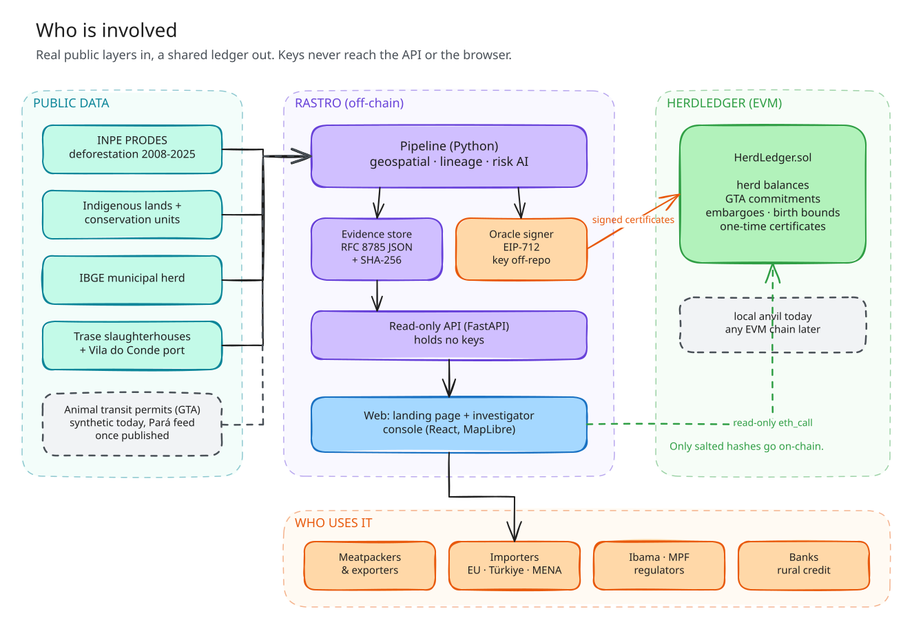</p>

| Part | Owns | Never does |
| --- | --- | --- |
| [`pipeline/`](pipeline/) (Python 3.12) | Real-layer ingestion, the synthetic world, geospatial analysis, lineage, risk scoring, evaluation, evidence bundles, certificate issuance | Serve users |
| [`contracts/`](contracts/) (Solidity, Foundry) | Herd balances, GTA uniqueness, embargoes, birth bounds, one-time certificates | Compute risk or read off-chain data |
| [`backend/`](backend/) (FastAPI) | Validated, versioned read API; certificate verification against the chain | Hold keys or write to the chain |
| [`web/`](web/) (React, MapLibre) | Public landing page and the investigator console | Decide a verdict or hold a private key |

## 5. How it works

### 5.1 From satellite layer to certificate

<p align="center">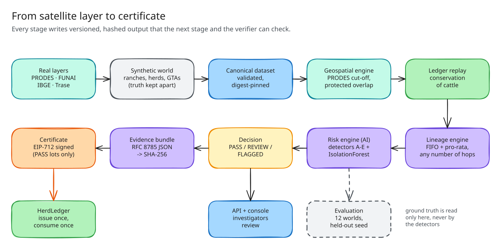</p>

1. **Real layers.** PRODES clearings 2008-2025, Indigenous lands and conservation units, the IBGE municipal herd, and
   Trase slaughterhouse and port locations.
2. **Synthetic world.** A deterministic generator (`rastro.synth`) builds 409 ranches on those layers with herds,
   births, permits and planted laundering. The ground truth goes into a separate partition that detectors never read.
3. **Canonical dataset.** Validated JSONL tables with a manifest and a logical digest, so every result can be traced
   to the exact input (`614e89ad…` for the evaluation world).
4. **Geospatial engine.** Each ranch is measured against PRODES (before, straddling or after the 2020 cut-off),
   Indigenous lands, protected areas and embargoes. A missing layer gives "unknown", never zero.
5. **Ledger replay** applies the HerdLedger rules to every permit and birth, exactly as the contract does.
6. **Lineage, risk, decision, evidence, certificate**: below.

### 5.2 HerdLedger: conservation of cattle

<p align="center">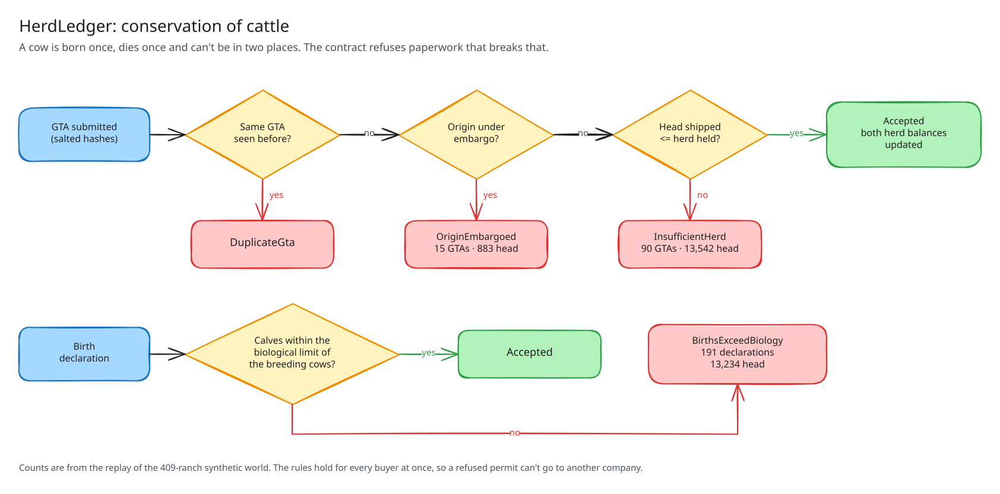</p>

The contract tracks herd balances per ranch (as salted hashes) and refuses events that break physics. The off-chain
replay and the on-chain totals agree exactly: opening herd 385,912, births 236,221, sent to slaughter or export
315,096, on hand 307,037.

### 5.3 Lot lineage

Each permit moves a lot. Rastro follows lots **first-in-first-out** through every farm they pass, and also computes a
**pro-rata** (fully mixed herd) alternative. Origins it can't resolve (missing permits, suppliers outside the study
area) are carried downstream as **unknown**, never dropped. A shipment's report lists its source ranches, their
share, the number of hops and the full upstream path of permits.

### 5.4 Risk engine and verdicts

<p align="center">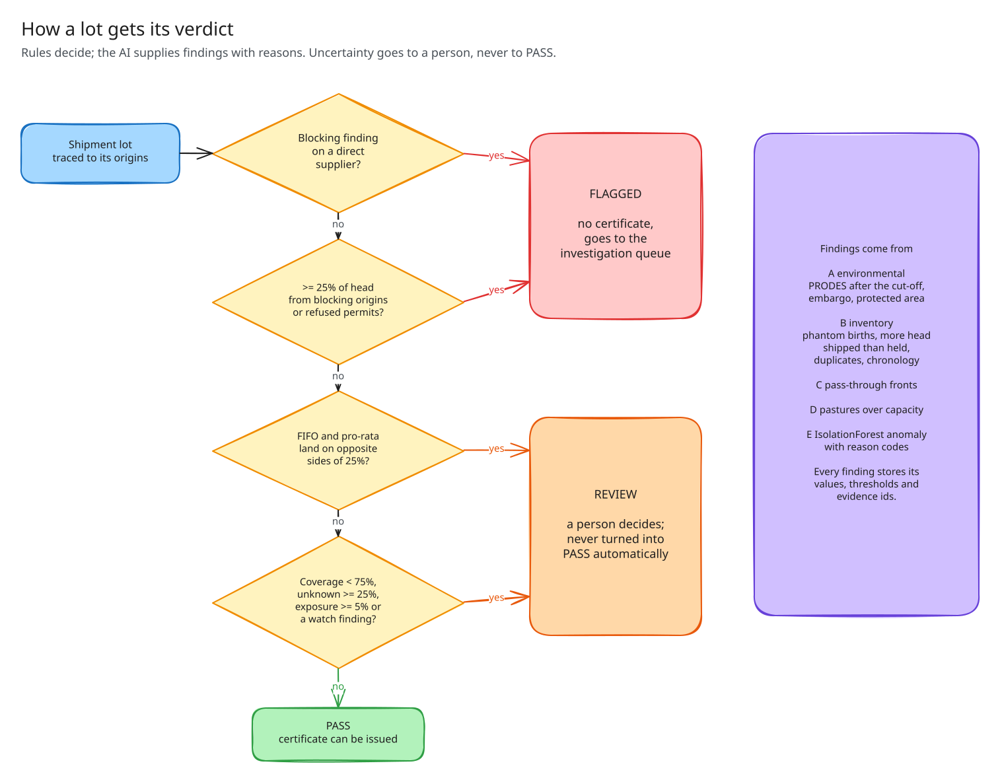</p>

The AI produces **findings**; fixed, tested rules turn findings into a **verdict**. A model never decides on its own,
and an uncertain lot always goes to a person.

| Detector | Looks for | Example code |
| --- | --- | --- |
| A, environmental | Clearing after the cut-off, embargoes, protected-area overlap | `POST2020_DEFORESTATION`, `EMBARGOED` |
| B, inventory | Phantom births, shipping more than held, duplicates, impossible chronology | `PHANTOM_BIRTHS`, `INSUFFICIENT_HERD` |
| C, pass-through | Fronts that buy and resell within days | `PASS_THROUGH` |
| D, over-capacity | More cattle than the pasture can hold | `OVER_CAPACITY` |
| E, IsolationForest | Unusual movement behaviour, with reason codes | `ANOMALY` |
| Lineage | Share of a lot from risky or unknown origins | `TAINTED_SUPPLY`, `UNKNOWN_ORIGIN` |

### 5.5 One-time certificates

<p align="center">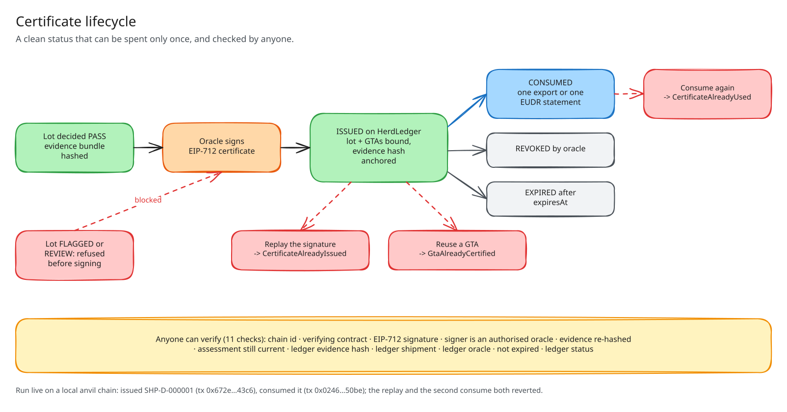</p>

- The evidence bundle is serialised as **RFC 8785 canonical JSON** and hashed with **SHA-256**.
- The oracle signs an **EIP-712** certificate (domain `Rastro HerdLedger`, version 1) binding the lot, its permits,
  the shipment, the verdict, the evidence hash, an expiry and a single-use nonce.
- Before submitting, the signer checks that its digest equals `HerdLedger.hashCertificate` on-chain.
- Run live on a local chain: a flagged lot refused, a review lot held, a clean lot issued (tx `0x672e…43c6`) and
  consumed (tx `0x0246…50be`). The replay reverted with `CertificateAlreadyIssued` and the second consumption with
  `CertificateAlreadyUsed`. Details: [docs/certificates.md](docs/certificates.md).

## 6. Screenshots

**Public site.** A lean, chart-first landing page. The full story opens after *Explore Rastro*.

| Results | Map story |
| --- | --- |
| 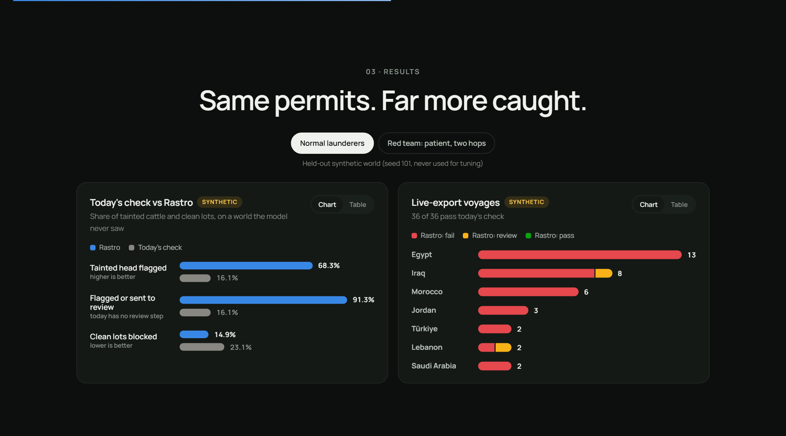 | 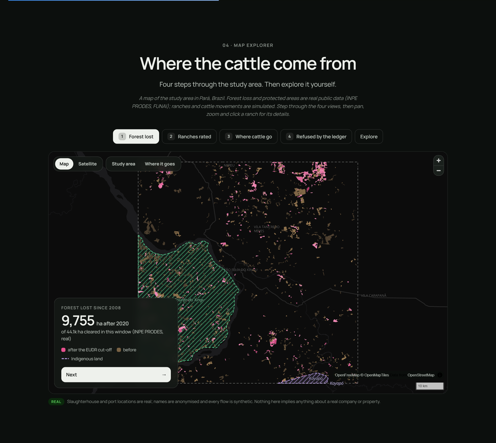 |
| **Trace a shipment** | **The ledger** |
| 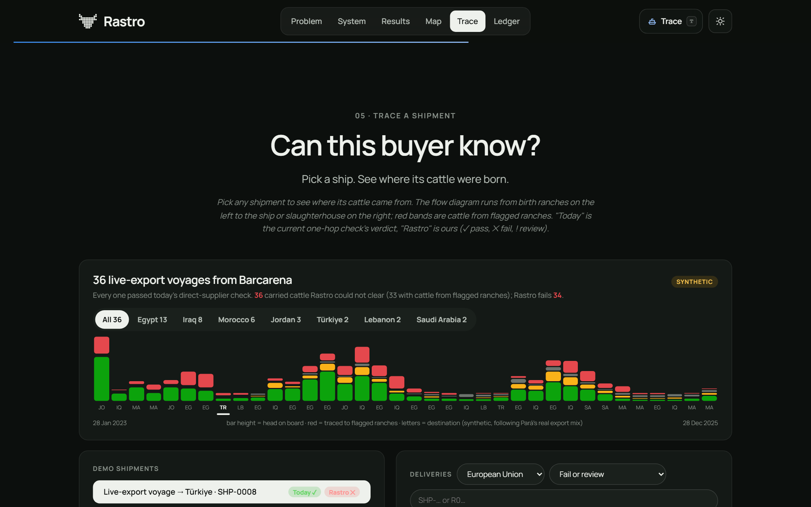 | 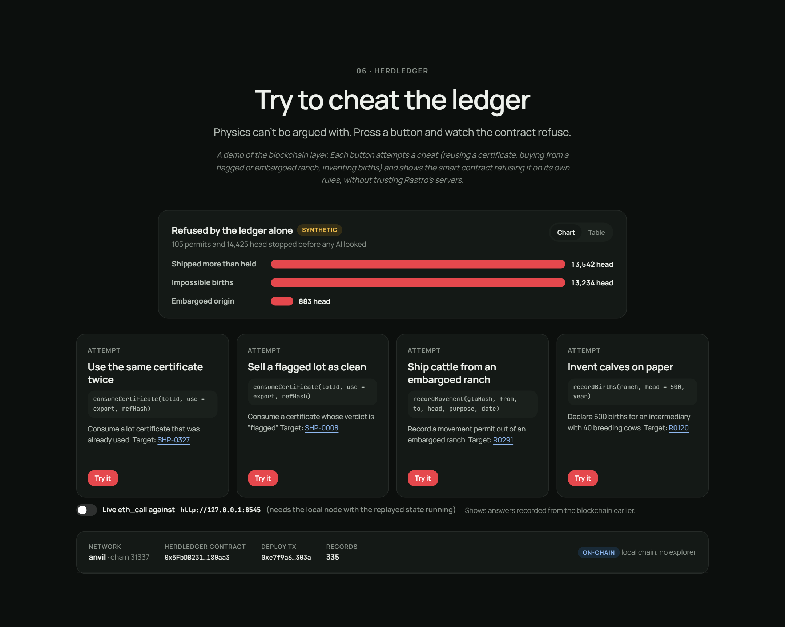 |

**Investigator console.** Every figure comes from the API; nothing is hard-coded in the UI.

| Overview | Shipment investigation |
| --- | --- |
| 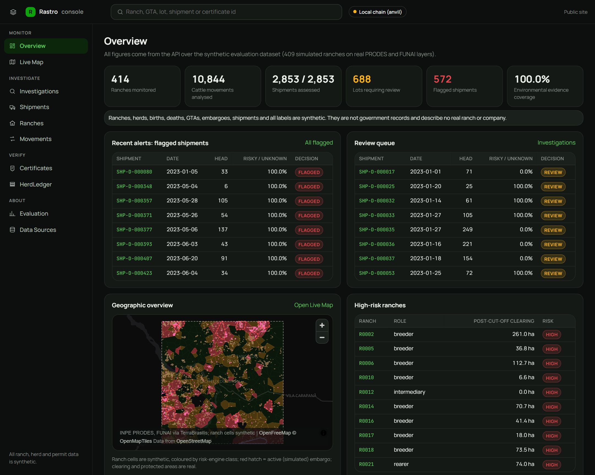 | 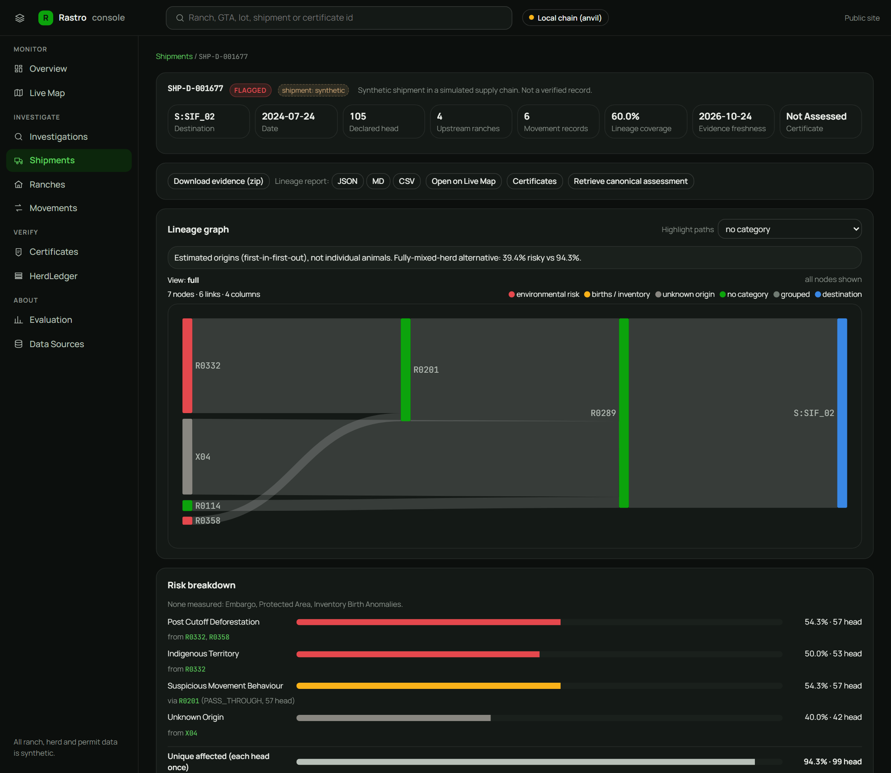 |
| **Certificate verification (11 checks)** | **Live map** |
| 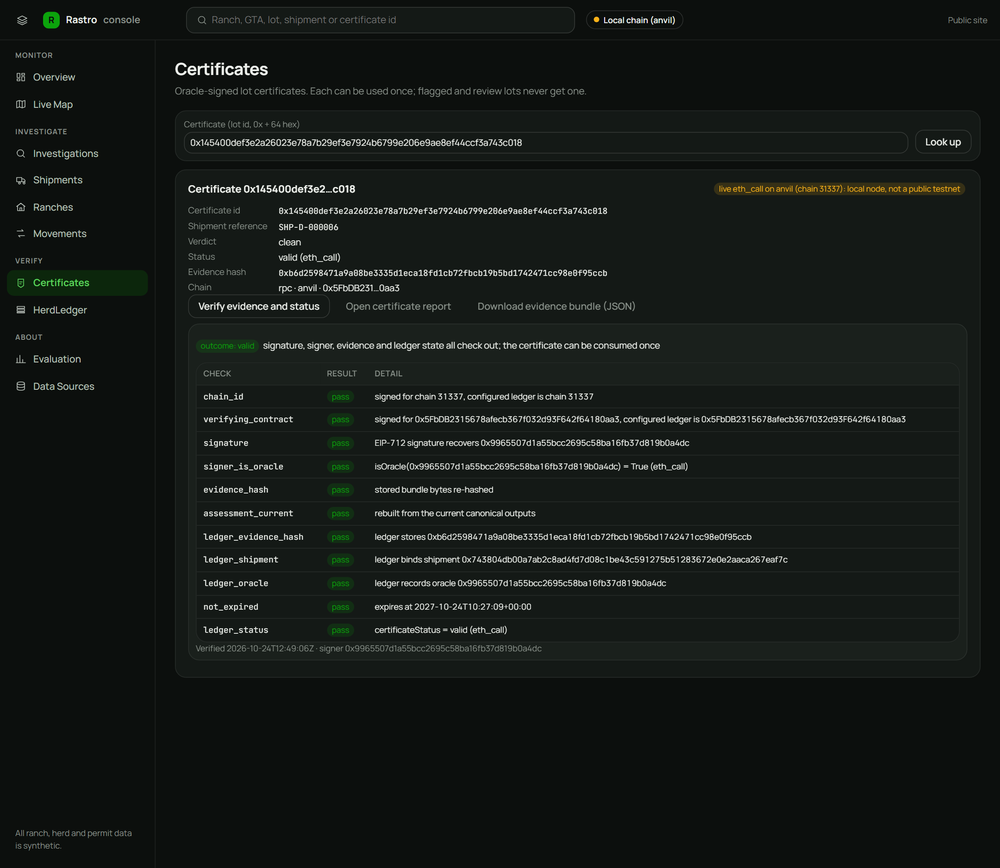 | 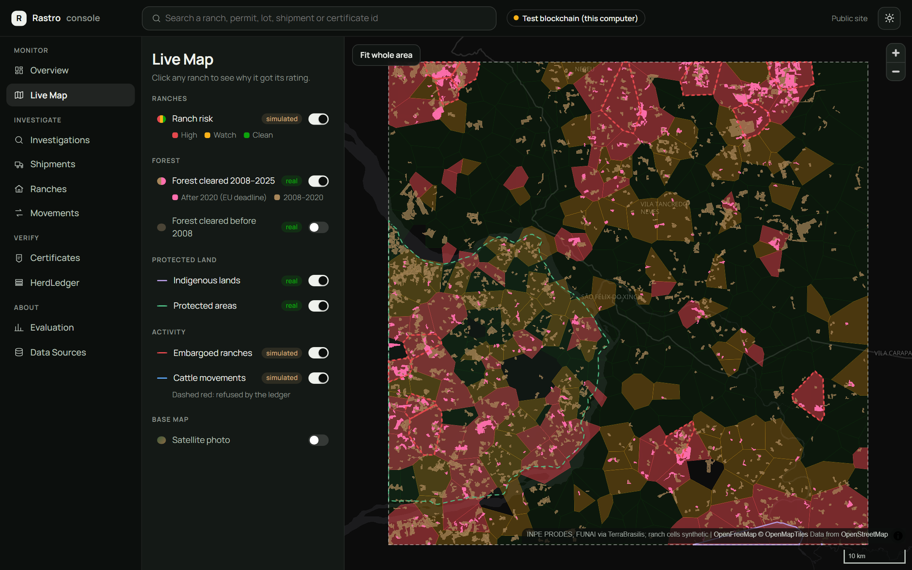 |

More: [ranch page](docs/screenshots/console-ranch.png), [HerdLedger page](docs/screenshots/console-ledger.png),
[evaluation page](docs/screenshots/console-evaluation.png), [problem section](docs/screenshots/landing-problem.png),
[system section](docs/screenshots/landing-system.png).

## 7. Getting started

**Prerequisites:** Python 3.12, Node 20+ (tested on 22), Foundry 1.8. On Windows the Foundry binaries can live in
`contracts/.tools/bin`. Copy [`.env.example`](.env.example) to `.env` only if you need non-default settings.

```bash
# 1. Data and AI (first run downloads the real layers, then they are cached)
cd pipeline
pip install -r requirements.txt -r requirements-dev.txt
python run_all.py                 # real layers -> synthetic world -> geospatial -> lineage -> risk -> evaluation
                                  # add --no-fetch after the first run

# 2. Ledger on a local chain
cd ../contracts
forge soldeer install && npm install
forge test
npm run demo:local -- --keep      # starts anvil, deploys HerdLedger, replays the world

# 3. API (read-only, holds no keys)
cd ../backend
python -m venv .venv && source .venv/bin/activate     # Windows: .venv\Scripts\activate
pip install -r requirements-dev.txt
uvicorn app.main:app --port 8000  # http://127.0.0.1:8000/docs

# 4. Web
cd ../web
npm install
npm run dev                       # landing: http://localhost:5173  console: http://localhost:5173/console.html
```

If port 8000 is taken, run the API on another port and build the console with `VITE_API_URL=http://127.0.0.1:<port>`.

**Certificates, red team and resets:**

```bash
cd pipeline
python -m rastro.certificates.issue demo ../data/synthetic/evaluation   # issue, refuse, consume, replay on anvil
python -m rastro.evaluation.run                                          # 12 worlds -> reports/evaluation/
cd .. && python scripts/reset_demo.py --chain                            # clear certificates and reviews, reset anvil
```

## 8. Demo in five minutes

| Step | Where | What to show |
| --- | --- | --- |
| 1 | Landing page | The problem in one screen. *Explore Rastro* opens the story. |
| 2 | Results | Today's check vs Rastro; toggle the red team. 36 of 36 voyages pass today's check. |
| 3 | Map story | Real PRODES clearing after the EUDR cut-off, ranches rated, where cattle go, what the ledger refused. |
| 4 | Trace | *Trace a ship to Türkiye*: the voyage today's check passes and Rastro fails, with its source ranches. |
| 5 | Console, Investigations | `SHP-D-001677`: lineage graph, risk breakdown, findings and "what could change this outcome". |
| 6 | Console, Certificates | Verify a live certificate: 11 checks, read from the chain with `eth_call`. |
| 7 | Terminal | Replay the certificate: `CertificateAlreadyIssued`. Consume twice: `CertificateAlreadyUsed`. |

Full runbook: [docs/demo-script.md](docs/demo-script.md).

## 9. Project structure and tech stack

```text
rastro/
├── pipeline/            Python: fetch, landscape, rastro package, tests
│   └── rastro/          synth · geospatial · lineage · risk · certificates · evaluation · schemas
├── contracts/           HerdLedger.sol, Foundry tests and invariants, replay and signer (ethers v6)
├── backend/             FastAPI read API, EIP-712 verification, chain adapter
├── web/                 React + Vite: landing page (index.html) and console (console.html), e2e checks
├── data/synthetic/      canonical datasets (manifests committed, tables regenerated)
├── reports/evaluation/  held-out metrics, confusion tables, error analysis
├── scripts/             reset_demo.py
└── docs/                architecture, API, data dictionary, threat model, diagrams, screenshots
```

| Layer | Technology |
| --- | --- |
| Data and AI | Python 3.12, GeoPandas, Shapely, scikit-learn (IsolationForest), Pydantic v2 |
| Ledger | Solidity 0.8.30, OpenZeppelin AccessControl and Pausable, Foundry, anvil, ethers v6 |
| Evidence | RFC 8785 JSON canonicalisation, SHA-256, EIP-712 typed signatures |
| API | FastAPI, pure-Python secp256k1 signature recovery, structured JSON logs, rate limiting |
| Web | React 18, TypeScript, Vite 6, MapLibre GL, OpenFreeMap tiles, vitest |

## 10. Testing

| Suite | Command | Result |
| --- | --- | --- |
| Pipeline | `cd pipeline && python -m pytest` | **152 passed** |
| Backend | `cd backend && python -m pytest` | **86 passed** |
| Contracts | `cd contracts && forge test` | **227 passed** (12 invariants), 100% line and branch coverage of `HerdLedger.sol` |
| Web unit | `cd web && npm test` | **18 passed** |
| Browser end-to-end | `cd web && API_URL=http://127.0.0.1:8000 npm run e2e` | **9 / 9** (needs the API, a built console and anvil) |

The tests cover duplicate permits, missing upstream records, negative inventory, impossible births, out-of-order
movements, missing geospatial layers, changed evidence files, duplicate and replayed certificates, expiry and invalid
oracle signatures. Full matrix: [docs/integration-report.md](docs/integration-report.md).

## 11. Security and trust model

- **No private key** in the source, the API or the browser. Anvil's public development keys are accepted only on
  chain 31337.
- **Signature safety:** EIP-712 domain bound to chain id and contract, single-use nonces, one certificate per lot and
  per permit, high-s signatures rejected, digest cross-checked with the contract.
- **API hardening:** strict input validation (unknown fields rejected), a path-traversal fix in certificate
  verification, CSV formula-injection guard, escaped HTML reports, per-client rate limiting, restricted CORS.
- **Honest labels:** the UI says *Local chain (anvil)* and never claims a public testnet. A failed request shows an
  error with its request id and is never replaced by sample data.
- **Accepted risk:** `maplibre-gl` 5.x has an advisory in its HTML sanitiser. Rastro never passes HTML to MapLibre, so
  the path is unreachable; the upgrade to 6.x is planned.

Threat model: [docs/threat-model.md](docs/threat-model.md).

## 12. Who would use it

| User | What Rastro gives them |
| --- | --- |
| **Ibama and the Federal Prosecutors (MPF)**, who run the meatpacking monitoring protocol | A ranked list of ranches and permits worth inspecting, with evidence |
| **Meatpackers and live-cattle exporters** | Indirect-supplier checks without seeing competitors' data |
| **EU importers** | EUDR due-diligence evidence from 30 Dec 2026, spendable once |
| **Importers in Türkiye, Egypt, Iraq and beyond** | The same assurance without an EU law forcing it |
| **Banks** lending under Brazil's rural-credit environmental rules | A check on where a borrower's cattle really come from |

**It scales with data, not hardware.** The pipeline runs on public layers for any Amazon municipality. Plugging in the
real GTA feed replaces the simulator with no change to the detectors or the contract.

## 13. Limitations and roadmap

| Limitation | What we'd do next |
| --- | --- |
| Permits are simulated until Pará publishes GTAs as the court ruled. | Ingest the published feed; pilot one municipality with a regulator. |
| Incomplete records over-block: with 10% of permits missing, 43.6% of clean lots are flagged. | Treat missing upstream records as review, not block, and weight by data-quality evidence. |
| First-in-first-out lineage is an estimate; real herds mix. | Lots between the FIFO and pro-rata estimates already go to review; add animal-level records when ear tags arrive (2030). |
| Paper permits can be forged. | Capacity and biology checks catch some forgeries; satellite pasture-capacity checks would catch more. |
| The export shipment binding is enforced by the consumption service, not the contract. | Make the contract revert when the consuming shipment differs from the signed one. |
| One trusted oracle signs certificates; the review endpoint has no authentication. | Multi-party oracle (regulator plus auditor), authenticated investigator accounts. |
| Local chain only. | Deploy HerdLedger to a public testnet and then a permissioned network run with the state agency. |

## 14. Real and synthetic data

| Real, public | Synthetic, calibrated |
| --- | --- |
| INPE PRODES deforestation 2008-2025 (2,675 polygons in the window, 9,754 ha cleared after 2020) | Ranch boundaries, herds, births, permits |
| Kayapó Indigenous land, Triunfo do Xingu protected area | Embargoes and laundering behaviour (the evaluation ground truth) |
| IBGE herd of São Félix do Xingu: 2,730,818 head (2025) | Which slaughterhouse buys what; voyage destinations follow Pará's real 2025 export mix |
| Slaughterhouse locations (Trase, CC BY 4.0), Vila do Conde port | |

## 15. Editing the diagrams

Every diagram in this README was drawn with [Excalidraw](https://excalidraw.com). The editable sources sit next to the
exported images in [`docs/diagrams/`](docs/diagrams):

| Diagram | Source |
| --- | --- |
| How laundering beats today's check | `02-laundering.excalidraw` |
| System overview | `01-system-context.excalidraw` |
| From satellite layer to certificate | `03-pipeline.excalidraw` |
| HerdLedger rules | `04-ledger-rules.excalidraw` |
| Verdict flow | `05-decision.excalidraw` |
| Certificate lifecycle | `06-certificate-lifecycle.excalidraw` |

To edit one, open [excalidraw.com](https://excalidraw.com) → *Open* → choose the `.excalidraw` file, then *Export
image* → SVG with *Embed scene* and *Background* on, and replace the matching `.svg`.

## 16. Sources

INPE PRODES / TerraBrasilis · FUNAI Indigenous lands · IBGE PPM table 3939 · Trase Brazil beef logistics map v6 ·
Human Rights Watch, *Tainted* (Oct 2025) and follow-up (Nov 2025) · Mighty Earth on the Pará traceability delay
(Dec 2025) · MPF/PA on the GTA publication ruling (Oct 2025) · European Commission EUDR review COM(2026) 191 ·
Sedap/Agência Pará and Agrifatto on Pará's live-cattle exports (2025) · Secex/Scot Consultoria via Compre Rural (2026).

More documentation: [architecture](docs/architecture.md) · [API](docs/api.md) ·
[data dictionary](docs/data-dictionary.md) · [evaluation](docs/evaluation.md) · [certificates](docs/certificates.md) ·
[threat model](docs/threat-model.md) · [integration report](docs/integration-report.md).

## 17. Team

**Team Rastro**, IEEE ClimateChain Global Hackathon 2026

- **Meghana Pabba**
- **Naga Bhargav Reddy**

<div align="center">

Code: MIT. Data keeps the licence of its source.

</div>
