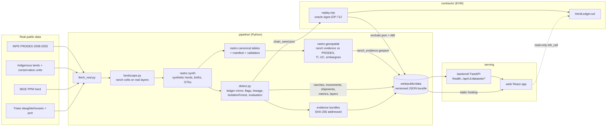
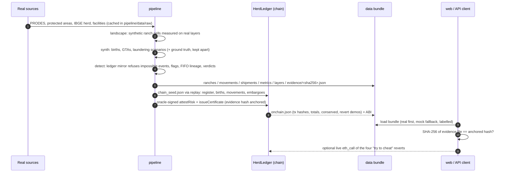

# Rastro architecture

Rastro has four parts with one rule each:

| Part | Owns | Never does |
|---|---|---|
| `pipeline/` (Python 3.12) | ingestion of real layers, the synthetic world, geospatial analysis, lineage, risk scoring, evaluation, evidence bundles, the chain seed | serve users; hold deployed-chain state |
| `contracts/` (Solidity 0.8.30, Foundry) | authoritative state transitions: herd balances, GTA uniqueness, embargoes, birth bounds, one-time certificates | compute risk; read off-chain data |
| `backend/` (FastAPI) | validated, versioned read API over the published bundle | hold keys; recompute risk |
| `web/` (Vite + React + TS) | visualisation and interaction; re-hashes evidence and simulates reverts | decide a verdict; hold a private key |

Oracle signatures (EIP-712) are produced by the replay tooling in `contracts/replay/` from a key in a gitignored env file. No key reaches `backend/` or the browser; the browser only issues read-only `eth_call`s.

## Components

The web app works from the static bundle alone (GitHub Pages), so the demo never depends on a running server or a restricted government feed. The API is the validated path for clients that need contract guarantees; both read the same files.

## Data flow

## Identifiers and hashing (shared across all parts)

See [data-dictionary.md](data-dictionary.md) for every field. The cross-cutting conventions:

| Thing | Off-chain id | On-chain id |
|---|---|---|
| Ranch | `R0001`… (synthetic), `X01`… external supplier | `sha256("rastro-demo-salt-v1\|" + id)` as `bytes32` |
| Sink | `S:<SIF\|SIE>_<n>` slaughterhouse, `P:BARCARENA` port | same salted hash |
| GTA | `GTA-PA-<year>-<seq6>`; refused attempts `GTA-PA-ATTEMPT-<seq4>` | salted hash of the GTA record |
| Shipment | `SHP-<seq4>` | certificate `lotId` = hash of the lot |
| Evidence | file `evidence/<sha256-hex>.json` | `evidenceHash` = SHA-256 of the file bytes |

Only salted hashes go on-chain. SPEC §4 says keccak256; the implementation uses SHA-256 of canonical JSON (`detect.py: h32`) for every off-chain-derived id, and both are 32-byte opaque values to the contract.

## Versioning

- Data files are contract **v1** (SPEC §6). Their Python definition is `backend/app/schemas/v1.py`; tests validate every real and mock file against it.
- API routes are prefixed `/api/v1`; data responses are wrapped as `{schema: "rastro.<dataset>/v1", source: "real"|"mock", data}`.
- Additive fields are allowed within v1. Renames, removals or narrowed enums require v2.
- On-chain: EIP-712 domain `Rastro HerdLedger`, version `1`.

## What is real and what is synthetic

Real: PRODES clearings, Indigenous-land and conservation-unit boundaries, IBGE municipal herd, slaughterhouse and port locations. Synthetic: ranch boundaries, herds, births, GTAs, embargoes, laundering behaviour and every result derived from them. The UI tags each; ground truth appears only in Evaluation mode.
